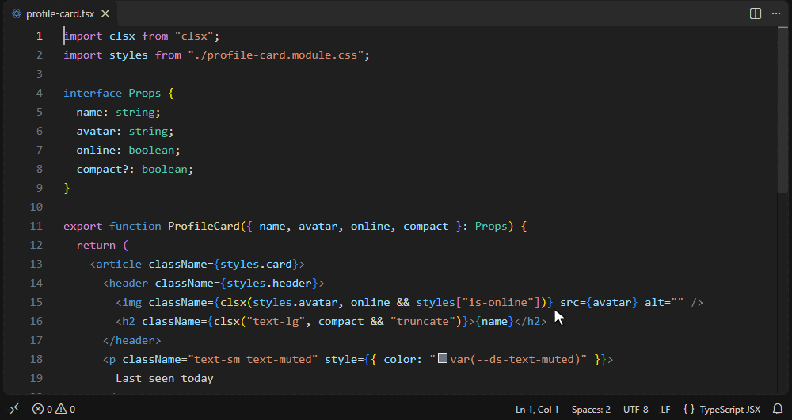
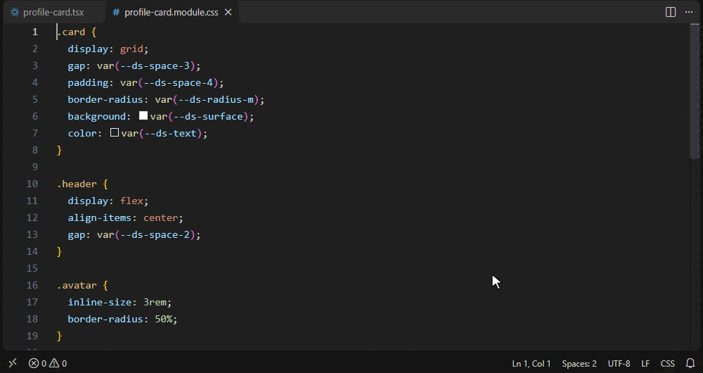

<p align="center">
  
</p>

<h1 align="center">CSS Compass</h1>

<p align="center">
  Ctrl+Click, hover and autocomplete for CSS Modules, utility classes and design tokens —<br>
  including the ones that live in <code>node_modules</code>.
</p>

<p align="center">
  <a href="LICENSE"></a>
  
  
</p>


## Why CSS Compass

- **One extension for all your CSS.** CSS Modules, global utility classes and custom properties
  usually need two or three extensions. CSS Compass covers them together.
- **Package CSS is first-class.** Tokens and utility classes from a design-system package get the
  same completion, hover and Go to Definition as your own files.
- **Fast and lean, measured.** No runtime dependencies, nothing scanned until you need it, and
  most requests answer in well under a millisecond once the index is built
  ([benchmarks](docs/benchmarks.md)).

## Features

### CSS Modules

For `import styles from "./card.module.css"` in TypeScript and JavaScript (React and others):

- **Go to Definition** on `styles` opens the file; on `styles.header` or `styles["is-online"]` it
  jumps straight to the rule.
- **Hover** shows the rule, its `@media` or `@layer` context and a link to the line.
- **Completion** after `styles.` lists only that file's classes, with a preview.
- **Warnings** for classes that don't exist in the imported file.


### Utility classes

Global classes, for example from a design system or your own `global.css`, in `className="…"`
and in `clsx(…)`, `cn(…)`, `cx(…)` and `classnames(…)` — including conditionals, arrays and
object keys:

- **Completion** after a quote or a space, labelled with where the class comes from.
- **Hover** shows the rule with its `@layer`.
- **Go to Definition** opens the line, also inside `node_modules`.



### Design tokens

Custom properties in CSS files and in strings in TypeScript and JavaScript
(`style={{ color: "var(--ds-accent)" }}`):

- **Completion** inside `var(` with the resolved value and a colour swatch.
- **Hover** shows every definition — `:root` and each theme — and resolves `var()` chains to the
  final value.
- **Go to Definition** jumps to the definition, or lists them when there are several.
- **Colour swatches** next to each `var(--x)` that resolves to a colour, also in
  `rgba(var(--x-rgb), 0.5)`.



### In CSS files

Classes from your global stylesheets complete inside `:global(.…)` in CSS Modules, with hover and
Go to Definition.

## Getting started

1. Install the extension:

   ```bash
   code --install-extension css-compass-0.1.0.vsix
   ```

2. Open a project. CSS Modules work right away, and global classes and tokens come from
   `src/**/*.css`.
3. To use a design system's stylesheet, add it to the sources in `.vscode/settings.json`, by
   package name or by path:

   ```json
   {
     "cssCompass.sources": ["src/**/*.css", "@acme/design-system/style.css"]
   }
   ```

   Package names resolve like Node does, through the package's `exports`. If your workspace
   already sets `cssVariables.lookupFiles`, those files are used when `cssCompass.sources` isn't
   set.

## Settings

| Setting | Default | Meaning |
|---|---|---|
| `cssCompass.sources` | `src/**/*.css` (+ `cssVariables.lookupFiles`) | CSS files for global classes and custom properties: globs relative to the workspace folder, or package names such as `@acme/design-system/style.css`. |
| `cssCompass.classFunctions` | `clsx`, `cn`, `cx`, `classnames` | Functions whose string arguments, array items and object keys are class names. |
| `cssCompass.localsConvention` | `asIs` | Same value as `css.modules.localsConvention` in your Vite config. |
| `cssCompass.diagnostics.unknownModuleClass` | `true` | Warn about `styles.x` when `.x` doesn't exist in the imported file. |
| `cssCompass.diagnostics.unknownGlobalClass` | `false` | Warn about class names that no CSS source defines. Off by default: classes from CSS outside the sources would be flagged too. |
| `cssCompass.debug.timings` | `false` | Log how long each request takes to the "CSS Compass" output channel. |

## Good to know

**Ctrl+Click goes straight to the CSS.** With Vite's types, TypeScript also answers Go to
Definition on `styles.header` (with its generic `declare module "*.module.css"`), which would
open a list with two entries. CSS Compass therefore sets
`"editor.gotoLocation.multipleDefinitions": "goto"` for TypeScript and JavaScript files. Side
effect: any Go to Definition with several results there, such as a function with overloads,
jumps to the first one. <kbd>Alt</kbd>+<kbd>F12</kbd> still shows them all. To get the list
back, for example only in TSX files:

```json
"[typescriptreact]": { "editor.gotoLocation.multipleDefinitions": "peek" }
```

**Limitations**

- Plain CSS only: no SCSS, Less or Stylus.
- `composes` and tsconfig `paths` in CSS Module imports aren't supported yet.
- Usages are found without a full TypeScript analysis, so a local variable that shadows `styles`
  is still treated as the CSS Module.
- In CSS files, VS Code's own completion also lists token names used in the current file, so a
  name can appear twice. The CSS Compass entry is the one with the value and the swatch.

## Performance

| | |
|---|---|
| Bundle | one 54 KB file, no runtime dependencies |
| Activation | about 10 ms; nothing is scanned at startup |
| Requests once the index is built | 0.002–0.3 ms for definition, hover and completion |
| First request on a real project | about 200 ms, mostly VS Code's file search |

Details and methods in [docs/benchmarks.md](docs/benchmarks.md).

## Development

```bash
pnpm install
pnpm typecheck && pnpm lint && pnpm format:check && pnpm test
pnpm test:integration   # in a downloaded VS Code, pinned in .vscode-test.mjs
pnpm bench              # results go to docs/benchmarks.md
pnpm package            # builds css-compass-<version>.vsix
```

The GIFs above are recorded from the `demo/` workspace with `pnpm record-demos` (needs
ImageMagick's `magick` on the `PATH`). The full specification is in [SPEC.md](SPEC.md).

## License

[MIT](LICENSE)
